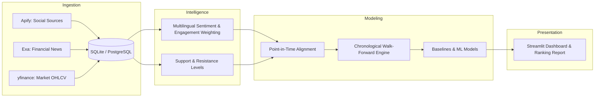

# HengSeng Sentiment Price Prediction Agent

> **CrowdWisdomTrading — AI Agents Developer Internship Assessment**  
> Candidate System Implementation & Research Pipeline  
> Author: Candidate  
> Reviewer: Gilad (CEO, CrowdWisdomTrading — `gilad@crowdwisdomtrading.com`)

---

## Executive Overview
The **HengSeng Sentiment Price Prediction Agent** is an end-to-end quantitative financial intelligence and machine learning system that forecasts next-period asset prices ($n+1$) by synthesizing alternative social sentiment, institutional financial news, and technical market indicators.

The agent monitors **5 liquid assets across 2 major Asian financial hubs** over the most recent 10-day trading window:
1. **Hong Kong Stock Exchange (HKEX / Hang Seng)**: `0700.HK` (Tencent), `9988.HK` (Alibaba), `3690.HK` (Meituan), `1810.HK` (Xiaomi), `1211.HK` (BYD).
2. **Korea Exchange (KRX / KOSPI)**: `005930.KS` (Samsung Electronics), `000660.KS` (SK Hynix), `035420.KS` (NAVER), `035720.KS` (Kakao), `005380.KS` (Hyundai Motor).

---

## Key Capabilities & Technical Highlights

- **Alternative Data Ingestion**:
  - **Apify Integration**: Collects real retail investor discussions from at least **2 independent social sources per exchange**:
    - *Hong Kong*: LIHKG forum discussions + Telegram HK financial channels (or AAStocks community).
    - *South Korea*: Naver Finance Stock Discussion Boards (종목토론실) + Telegram Korean channels (or Daum Finance).
  - **Exa Integration**: Semantic search extracting high-relevance financial news articles covering earnings, regulatory actions, and corporate developments.
  - **Market Price Ingestion**: Clean, split-adjusted OHLCV price bars fetched via `yfinance` with `FinanceDataReader` fallback.
- **Sentiment Intelligence & Engagement Weighting**:
  - Multilingual NLP pipeline combining domain-specific **FinBERT** (for English news) and **Twitter-XLM-RoBERTa** (for Cantonese, Traditional Chinese, and Korean retail forum slang).
  - Isolated source-level scoring prior to composite synthesis.
  - Engagement multiplier weighting posts by upvotes, views, reposts, and author follower influence.
- **Entity Signals & Technical Levels**:
  - Per-ticker extraction of: Current Price, Composite Sentiment, Trend Direction (`Bullish` / `Bearish` / `Neutral`), Trading Position (`Long` / `Short` / `Flat`), and Algorithmic Support & Resistance Levels ($S_1, S_2, R_1, R_2$) based on rolling swing pivots and volume-by-price clusters.
- **Leakage-Free Quantitative Prediction**:
  - Stationary percentage return modeling ($R_{t+1}$) converted to implied price $\hat{P}_{t+1} = P_t(1 + \hat{R}_{t+1})$.
  - Chronological **Walk-Forward Validation** (expanding window) with a 1-period embargo to prevent lookahead bias.
  - Benchmarked against **Naive Random Walk Persistence**, **Technical-Only**, and **Sentiment-Only** baselines.
- **Interactive Visual Dashboard**:
  - Built with **Streamlit** and **Plotly**.
  - Cross-exchange asset ranking table by social mentions, sentiment, and direction.
  - Interactive candlestick chart with support/resistance overlays and sentiment indicator bars.
  - Real scraped post provenance explorer and out-of-sample prediction vs actual trajectory plots.

---

## Architecture & Data Flow



---

## Project Structure

```
hengseng-sentiment-agent/
├── assignment.pdf                  # Original assignment PDF specification
├── AGENTS.md                       # Engineering conventions & instructions for AI coding agents
├── README.md                       # System overview & quickstart guide
├── pyproject.toml                  # Python dependency configuration
├── .env.example                    # Environment variable template
├── docs/                           # Comprehensive technical documentation
│   ├── PRD.md                      # Product requirements & acceptance criteria
│   ├── ARCHITECTURE.md             # System architecture & data flow
│   ├── DATABASE_SCHEMA.md          # Database schema & ER diagrams
│   ├── DATA_SOURCES.md             # Social sources, Apify actors & Exa queries
│   ├── ML_STRATEGY.md              # Sentiment, feature engineering & validation
│   ├── DEVELOPMENT_PLAN.md         # 5-7 day phased roadmap
│   └── DECISIONS.md                # Architecture Decision Records (ADRs)
├── src/                            # Production source code
│   ├── config.py                   # Pydantic environment configuration
│   ├── ingestion/                  # Apify, Exa, and market price connectors
│   ├── storage/                    # SQLAlchemy database models & repositories
│   ├── nlp/                        # Sentiment scoring & technical level extractors
│   ├── features/                   # Point-in-time alignment & feature matrix
│   ├── models/                     # Predictors, baselines & walk-forward evaluator
│   ├── dashboard/                  # Streamlit visual dashboard
│   └── pipeline/                   # Master orchestrator CLI
├── data/                           # Local SQLite database & raw cache (git-ignored)
└── tests/                          # Automated unit, integration, and leakage tests
```

---

## Quickstart & Installation

### 1. Prerequisites
- Python 3.11+
- Virtual environment tool (`venv`, `poetry`, or `uv`)

### 2. Setup Environment
```bash
# Clone the repository
git clone <repository-url>
cd hengseng-sentiment-agent

# Create and activate virtual environment
python -m venv .venv
# On Windows:
.venv\Scripts\activate
# On Linux/macOS:
source .venv/bin/activate

# Install dependencies
pip install -r requirements.txt
```

### 3. Configure API Credentials
Copy `.env.example` to `.env` and insert your credentials:
```bash
cp .env.example .env
```
Required environment keys:
- `APIFY_API_TOKEN`: Your personal Apify API token.
- `EXA_API_KEY`: Your personal Exa API key.
- `DATABASE_URL`: `sqlite:///data/sentiment_agent.db` (default).

### 4. Run the Pipeline
```bash
# Ingest data (Apify, Exa, Market Prices)
python -m src.pipeline.run --stage ingest

# Extract sentiment and technical levels
python -m src.pipeline.run --stage process

# Train models and run walk-forward validation
python -m src.pipeline.run --stage train

# Or run the complete end-to-end pipeline:
python -m src.pipeline.run --stage all
```

### 5. Launch the Visual Dashboard
```bash
streamlit run src/dashboard/app.py
```

---

## Documentation Index
- [Product Requirements Document (PRD)](docs/PRD.md)
- [System Architecture & Data Flow](docs/ARCHITECTURE.md)
- [Database Schema & ER Diagrams](docs/DATABASE_SCHEMA.md)
- [Data Sources, Apify Actors & Exa Queries](docs/DATA_SOURCES.md)
- [Machine Learning & Sentiment Strategy](docs/ML_STRATEGY.md)
- [Development Plan & Timeline](docs/DEVELOPMENT_PLAN.md)
- [Architecture Decision Records (ADRs)](docs/DECISIONS.md)

