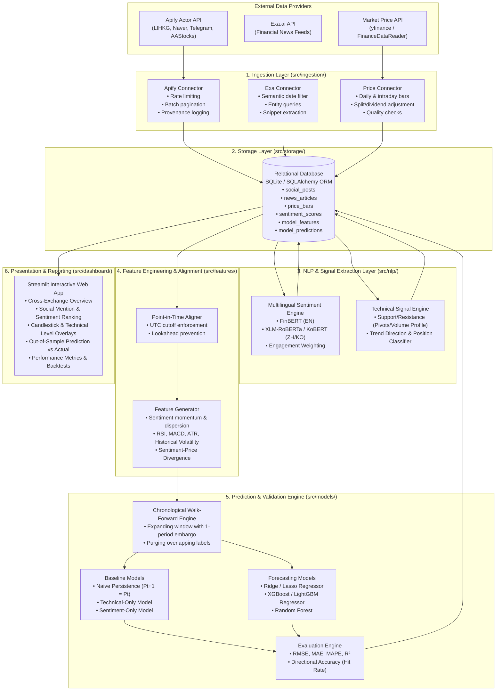

# System Architecture & Data Flow

## 1. High-Level Architecture Overview

The **HengSeng Sentiment Price Prediction Agent** is designed as a modular, decoupled data and ML system. It follows standard quantitative pipeline principles: strict separation between raw data ingestion, point-in-time feature engineering, predictive modeling, and interactive visualization.

---

## 2. End-to-End Data Flow

### Step 1: Ingestion & Provenance Recording
1. **Apify Ingestion**: The orchestrator triggers Apify Actors targeting 5 assets for HKEX and 5 assets for KRX over the preceding 10 days. The actor responses return JSON records containing post IDs, timestamps, full text, author IDs, follower counts, likes, reposts, and views.
2. **Exa Ingestion**: Using `exa-py`, the orchestrator queries financial news specifically matching the ticker, company name, and key executive names within the last 10 days.
3. **Price Ingestion**: Daily (and hourly) OHLCV bars are retrieved via `yfinance`, validated for missing timestamps or zero-volume anomalies, and stored in `price_bars`.
4. **Data Provenance**: Every record is stored with `raw_payload`, `source_actor_id`, `source_url`, and `ingested_at_utc`.

### Step 2: NLP & Technical Signal Extraction
1. **Language Detection & Cleaning**: Text is stripped of spam, duplicate retweets, and HTML tags while retaining financial tickers and numbers.
2. **Sentiment Scoring**: Text is fed through a domain-specific multilingual sentiment pipeline. Output probabilities are transformed into a normalized polarity score $s \in [-1.0, +1.0]$ with associated confidence $c \in [0.0, 1.0]$.
3. **Engagement Weighting**: High-reach posts (e.g., thousands of views, high follower accounts) are assigned higher weights than obscure bot posts.
4. **Technical Levels & Position**: From historical price bars up to $t$, the system computes:
   - Primary Support ($S_1$) and Secondary Support ($S_2$)
   - Primary Resistance ($R_1$) and Secondary Resistance ($R_2$)
   - Trend Direction (`Bullish` / `Bearish` / `Neutral`)
   - Proposed Trading Position (`Long` / `Short` / `Flat`) derived from rule-based synthesis of composite sentiment and technical oscillator conditions.

### Step 3: Point-in-Time Alignment & Feature Engineering
1. **Cutoff Rule**: For a given market bar ending at timestamp $t$ (e.g., market close at 16:00 HKT for HKEX), only social posts and news published in $(t-1, t]$ are aggregated into bar $t$.
2. **Feature Matrix Construction**:
   - Social: Mention count, sentiment mean, sentiment weighted mean, sentiment momentum ($\Delta S$), positive-to-negative ratio.
   - News: Article count, news sentiment mean.
   - Market Technicals: 1-day return, 5-day return, 10-day volatility, RSI(14), MACD histogram, ATR(14), volume ratio.
   - Cross-domain: Sentiment-Price Divergence ($Z_{\text{sentiment}} - Z_{\text{return}}$).
3. **Target Generation**:
   - Return target: $R_{t+1} = \frac{P_{t+1} - P_t}{P_t}$
   - Absolute price: $P_{t+1}$

### Step 4: Machine Learning & Walk-Forward Validation
1. **Expanding Window Splits**:
   - Fold 1: Train on days $[1 \dots 5]$, predict day $6$.
   - Fold 2: Train on days $[1 \dots 6]$, predict day $7$.
   - Fold $k$: Train on days $[1 \dots k+4]$, predict day $k+5$.
2. **Embargo & Purging**: A 1-period gap is enforced between feature observation and target evaluation to guarantee zero leakage.
3. **Model Execution**:
   - Fit Baselines (Random Walk, Technical-Only).
   - Fit ML Models (Ridge, XGBoost).
   - Record predicted return $\hat{R}_{t+1}$ and computed predicted price $\hat{P}_{t+1} = P_t(1 + \hat{R}_{t+1})$.
4. **Metrics Computation**: Compare out-of-sample predictions against actual realized market prices.

### Step 5: Visual Reporting via Streamlit
The user interacts with an intuitive, multi-view dashboard:
- **Exchange Leaderboard**: Assets ranked by social buzz, sentiment, direction, and trading posture.
- **Deep-Dive Asset View**: Synchronized charts displaying candlestick prices, support/resistance bands, sentiment overlay, and recent news articles.
- **Model Validation Dashboard**: Actual vs Predicted price trajectories with RMSE, MAE, and Directional Hit Rate.

---

## 3. Directory & Module Responsibilities

| Module | Directory | Key Classes / Functions | Primary Responsibility |
|---|---|---|---|
| **Configuration** | `src/config.py` | `Settings` (pydantic) | Validates environment variables, API tokens, paths, and defaults |
| **Ingestion** | `src/ingestion/apify_client.py` | `ApifyIngestionService` | Executes Apify actors, handles retries, parses post schemas |
| | `src/ingestion/exa_client.py` | `ExaIngestionService` | Performs semantic search on Exa, pulls full article text |
| | `src/ingestion/price_client.py` | `PriceDataService` | Fetches OHLCV bars via `yfinance` & `FinanceDataReader` |
| **Storage** | `src/storage/database.py` | `DatabaseManager`, `Base` | SQLAlchemy engine, session maker, SQLite PRAGMA tuning |
| | `src/storage/models.py` | `SocialPost`, `PriceBar`, etc. | ORM table definitions with constraints and foreign keys |
| | `src/storage/repository.py` | `DataRepository` | Clean CRUD operations and query helpers |
| **NLP** | `src/nlp/sentiment.py` | `SentimentScorer` | Multilingual sentiment inference & engagement weighting |
| | `src/nlp/levels.py` | `TechnicalLevelExtractor` | Algorithmic pivot detection, support/resistance, position logic |
| **Features** | `src/features/aligner.py` | `TimeSeriesAligner` | Point-in-time windowing and UTC cutoff mapping |
| | `src/features/builder.py` | `FeatureBuilder` | Computes technical indicators and composite sentiment signals |
| **Models** | `src/models/baselines.py` | `RandomWalkBaseline`, `TechnicalOnly` | Benchmark models for rigorous comparison |
| | `src/models/predictors.py` | `XGBoostPredictor`, `RidgePredictor` | ML models predicting next-period price returns |
| | `src/models/validation.py` | `WalkForwardValidator` | Expanding-window out-of-sample evaluation harness |
| **Dashboard** | `src/dashboard/app.py` | Streamlit app | Visual rankings, interactive charts, and model reports |
| **Pipeline** | `src/pipeline/orchestrator.py` | `PipelineOrchestrator` | End-to-end execution CLI (`python -m src.pipeline.run`) |

---

## 4. Error Handling, Rate Limiting & Resilience Strategy

1. **Exponential Backoff**: All external API calls (Apify, Exa, Yahoo Finance) use exponential backoff (`tenacity` library) with jitter for 429 (Rate Limit) and 5xx (Server Error) responses.
2. **Partial Run Resilience**: Ingestion stores raw payloads immediately upon retrieval. If an actor run fails halfway through, previously persisted posts are preserved.
3. **Data Quality Assertions**:
   - `PriceBar` validation: `low <= min(open, close)` and `high >= max(open, close)`.
   - `SocialPost` validation: valid ISO timestamp, non-empty text.
4. **Deterministic Fallbacks**: If a specific social platform actor is temporarily rate-limited during evaluation, the system can fallback to cached raw data or secondary actors while logging explicit provenance warnings.

