# Database Schema Specification

## 1. Overview & Storage Engine Choice
To ensure zero friction and 100% reproducibility for the CrowdWisdomTrading evaluation team, the default storage engine is **SQLite** (file-based: `data/sentiment_agent.db`). 

All models are defined using **SQLAlchemy 2.0 ORM**, allowing seamless, zero-code migration to **PostgreSQL** simply by updating the `DATABASE_URL` environment variable.

---

## 2. Entity-Relationship Diagram

```mermaid
erDiagram
    EXCHANGE ||--o{ ASSET : contains
    ASSET ||--o{ SOCIAL_POST : mentions
    ASSET ||--o{ NEWS_ARTICLE : covers
    ASSET ||--o{ PRICE_BAR : has
    ASSET ||--o{ TECHNICAL_LEVEL : exhibits
    ASSET ||--o{ MODEL_FEATURE : generates
    ASSET ||--o{ MODEL_PREDICTION : forecasts
    
    SOCIAL_POST ||--o{ SENTIMENT_SCORE : scores
    NEWS_ARTICLE ||--o{ SENTIMENT_SCORE : scores
    PIPELINE_RUN ||--o{ MODEL_PREDICTION : logs

    EXCHANGE {
        int id PK
        string code UK "e.g. HKEX, KRX"
        string name "e.g. Hong Kong Stock Exchange"
        string timezone "Asia/Hong_Kong or Asia/Seoul"
        string currency "HKD, KRW"
    }

    ASSET {
        int id PK
        int exchange_id FK
        string ticker UK "e.g. 0700.HK, 005930.KS"
        string name "e.g. Tencent Holdings"
        string sector "Technology, Consumer, Auto"
        string currency "HKD, KRW"
        boolean is_active
    }

    SOCIAL_POST {
        int id PK
        int asset_id FK
        string platform "LIHKG, Telegram, Naver, Daum, AAStocks"
        string actor_id "Apify Actor ID used"
        string raw_post_id "Unique post ID from source"
        string author_id "Username or user hash"
        int author_followers "Follower or subscriber count"
        text post_text "Full extracted text"
        string post_url "Direct URL to source post"
        datetime timestamp_utc "Post creation time in UTC"
        int likes_count "Likes or upvotes"
        int reposts_count "Retweets or forwards"
        int views_count "Impression or view count"
        int comments_count "Number of replies"
        json raw_payload "Full JSON returned by Apify"
        datetime ingested_at_utc
    }

    NEWS_ARTICLE {
        int id PK
        int asset_id FK
        string exa_id "Exa unique article ID"
        string title "Headline"
        string url "Canonical URL"
        text snippet "Exa highlights or summary"
        text full_text "Full article text if retrieved"
        datetime published_date_utc "Article timestamp in UTC"
        float exa_score "Exa relevance score"
        string domain "e.g. bloomberg.com, reuters.com"
        json raw_payload "Full Exa response payload"
        datetime ingested_at_utc
    }

    PRICE_BAR {
        int id PK
        int asset_id FK
        string timeframe "1d, 1h, 15m"
        datetime timestamp_utc "Bar opening or closing time in UTC"
        float open "Open price"
        float high "High price"
        float low "Low price"
        float close "Close price"
        float adjusted_close "Split/dividend adjusted close"
        bigint volume "Trading volume"
    }

    SENTIMENT_SCORE {
        int id PK
        string source_type "social_post or news_article"
        int source_id "Foreign key to social_posts.id or news_articles.id"
        string model_name "e.g. FinBERT, XLM-RoBERTa"
        float raw_score "Score between -1.0 and +1.0"
        float confidence "Model softmax confidence [0, 1]"
        string label "positive, neutral, negative"
        float engagement_weight "Computed engagement multiplier"
        datetime computed_at_utc
    }

    TECHNICAL_LEVEL {
        int id PK
        int asset_id FK
        datetime timestamp_utc "Observation timestamp in UTC"
        float current_price "Price at evaluation time"
        float support_1 "Primary support level"
        float support_2 "Secondary support level"
        float resistance_1 "Primary resistance level"
        float resistance_2 "Secondary resistance level"
        string trend_direction "Bullish, Bearish, Neutral"
        string suggested_position "Long, Short, Flat"
        string calculation_method "Rolling Pivot + Volume Profile"
        datetime computed_at_utc
    }

    MODEL_FEATURE {
        int id PK
        int asset_id FK
        datetime timestamp_utc "Bar end timestamp in UTC"
        string timeframe "1d"
        int social_mentions_count "Total posts in window"
        float social_sentiment_mean "Simple mean of sentiment"
        float social_sentiment_weighted "Engagement-weighted sentiment"
        float social_sentiment_momentum "Change in sentiment from t-1"
        int news_articles_count "Total news articles in window"
        float news_sentiment_mean "Mean news sentiment"
        float composite_sentiment "Synthesized social + news score"
        float return_lag1 "1-bar return"
        float return_lag5 "5-bar return"
        float rsi_14 "Relative Strength Index"
        float macd_hist "MACD histogram value"
        float atr_14 "Average True Range"
        float hist_vol_10 "10-bar annualized historical volatility"
        float volume_ratio "Current volume / 5-day mean volume"
        float sentiment_price_divergence "Standardized sentiment minus return"
        float target_next_return "Target R_{t+1}"
        float target_next_price "Target P_{t+1}"
    }

    MODEL_PREDICTION {
        int id PK
        int pipeline_run_id FK
        int asset_id FK
        string model_name "XGBoost, Ridge, RandomWalk"
        string model_version "1.0.0"
        datetime feature_cutoff_utc "Observation time t"
        datetime target_timestamp_utc "Forecasted time t+1"
        float base_price "P_t at forecast time"
        float predicted_return "Predicted R_{t+1}"
        float predicted_price "Predicted P_{t+1}"
        string predicted_direction "Bullish, Bearish, Neutral"
        float actual_price "Actual realized P_{t+1}"
        string actual_direction "Actual realized direction"
        float error_abs "Absolute price error"
        float error_pct "Absolute percentage error"
        boolean directional_correct "Whether sign(predicted) == sign(actual)"
        datetime generated_at_utc
    }

    PIPELINE_RUN {
        int id PK
        string run_id UK "UUID"
        string pipeline_stage "ingest, features, train, full"
        string status "running, completed, failed"
        datetime started_at_utc
        datetime finished_at_utc
        text error_message
        json run_metrics "Overall RMSE, MAE, Hit Rate"
    }
```

---

## 3. Detailed Table Specifications

### 3.1. `exchanges`
| Column | Type | Constraints | Description |
|---|---|---|---|
| `id` | INTEGER | PRIMARY KEY AUTOINCREMENT | Unique exchange identifier |
| `code` | VARCHAR(16) | UNIQUE, NOT NULL | Ticker exchange symbol (`HKEX`, `KRX`) |
| `name` | VARCHAR(128) | NOT NULL | Human-readable exchange name |
| `timezone` | VARCHAR(64) | NOT NULL | IANA timezone (`Asia/Hong_Kong`, `Asia/Seoul`) |
| `currency` | VARCHAR(8) | NOT NULL | Base trading currency (`HKD`, `KRW`) |

### 3.2. `assets`
| Column | Type | Constraints | Description |
|---|---|---|---|
| `id` | INTEGER | PRIMARY KEY AUTOINCREMENT | Unique asset identifier |
| `exchange_id` | INTEGER | FOREIGN KEY (`exchanges.id`), NOT NULL | Associated exchange |
| `ticker` | VARCHAR(16) | UNIQUE, NOT NULL | Normalized ticker symbol (`0700.HK`, `005930.KS`) |
| `name` | VARCHAR(128) | NOT NULL | Official company name |
| `sector` | VARCHAR(64) | NOT NULL | Business classification sector |
| `currency` | VARCHAR(8) | NOT NULL | Currency of asset quote |
| `is_active` | BOOLEAN | DEFAULT TRUE | Active tracking toggle |

**Indexes**:
- `ix_assets_ticker` ON `assets(ticker)`
- `ix_assets_exchange_id` ON `assets(exchange_id)`

### 3.3. `social_posts`
| Column | Type | Constraints | Description |
|---|---|---|---|
| `id` | INTEGER | PRIMARY KEY AUTOINCREMENT | Unique internal post record ID |
| `asset_id` | INTEGER | FOREIGN KEY (`assets.id`), NOT NULL | Targeted asset |
| `platform` | VARCHAR(32) | NOT NULL | Source platform (`LIHKG`, `Naver`, `Telegram`, `AAStocks`) |
| `actor_id` | VARCHAR(128) | NOT NULL | Apify Actor ID used to ingest this item |
| `raw_post_id` | VARCHAR(128) | NOT NULL | Source-native unique post/message identifier |
| `author_id` | VARCHAR(128) | NULLABLE | Author identifier or handle |
| `author_followers` | INTEGER | DEFAULT 0 | Follower/subscriber count of author |
| `post_text` | TEXT | NOT NULL | Extracted clean text of post |
| `post_url` | VARCHAR(512) | NULLABLE | Web URL to the live post |
| `timestamp_utc` | DATETIME | NOT NULL | Publication timestamp in UTC |
| `likes_count` | INTEGER | DEFAULT 0 | Likes or positive reactions |
| `reposts_count` | INTEGER | DEFAULT 0 | Shares, retweets, or forwards |
| `views_count` | INTEGER | DEFAULT 0 | Post impression count |
| `comments_count` | INTEGER | DEFAULT 0 | Comment reply count |
| `raw_payload` | JSON | NOT NULL | Full raw API response object |
| `ingested_at_utc` | DATETIME | DEFAULT CURRENT_TIMESTAMP | Ingestion audit timestamp |

**Indexes**:
- `ix_social_posts_asset_time` ON `social_posts(asset_id, timestamp_utc)`
- `ix_social_posts_platform` ON `social_posts(platform)`
- `ix_social_posts_raw_post` ON `social_posts(platform, raw_post_id)` UNIQUE

### 3.4. `news_articles`
| Column | Type | Constraints | Description |
|---|---|---|---|
| `id` | INTEGER | PRIMARY KEY AUTOINCREMENT | Unique internal article ID |
| `asset_id` | INTEGER | FOREIGN KEY (`assets.id`), NOT NULL | Targeted asset |
| `exa_id` | VARCHAR(128) | UNIQUE, NOT NULL | Exa document ID |
| `title` | VARCHAR(512) | NOT NULL | Headline text |
| `url` | VARCHAR(1024) | NOT NULL | Web link |
| `snippet` | TEXT | NULLABLE | Exa extracted highlight text |
| `full_text` | TEXT | NULLABLE | Full article body text |
| `published_date_utc` | DATETIME | NOT NULL | Publication timestamp in UTC |
| `exa_score` | FLOAT | NULLABLE | Relevance match score from Exa |
| `domain` | VARCHAR(128) | NULLABLE | Publisher website domain |
| `raw_payload` | JSON | NOT NULL | Full raw Exa result payload |
| `ingested_at_utc` | DATETIME | DEFAULT CURRENT_TIMESTAMP | Ingestion audit timestamp |

**Indexes**:
- `ix_news_articles_asset_time` ON `news_articles(asset_id, published_date_utc)`
- `ix_news_articles_domain` ON `news_articles(domain)`

### 3.5. `price_bars`
| Column | Type | Constraints | Description |
|---|---|---|---|
| `id` | INTEGER | PRIMARY KEY AUTOINCREMENT | Unique price bar ID |
| `asset_id` | INTEGER | FOREIGN KEY (`assets.id`), NOT NULL | Targeted asset |
| `timeframe` | VARCHAR(8) | NOT NULL | Bar interval (`1d`, `1h`) |
| `timestamp_utc` | DATETIME | NOT NULL | Bar timestamp in UTC |
| `open` | FLOAT | NOT NULL | Open price |
| `high` | FLOAT | NOT NULL | High price |
| `low` | FLOAT | NOT NULL | Low price |
| `close` | FLOAT | NOT NULL | Close price |
| `adjusted_close` | FLOAT | NOT NULL | Split/dividend adjusted close |
| `volume` | BIGINT | NOT NULL | Traded volume |

**Indexes**:
- `ix_price_bars_asset_timeframe_time` ON `price_bars(asset_id, timeframe, timestamp_utc)` UNIQUE

### 3.6. `sentiment_scores`
| Column | Type | Constraints | Description |
|---|---|---|---|
| `id` | INTEGER | PRIMARY KEY AUTOINCREMENT | Unique score record ID |
| `source_type` | VARCHAR(16) | NOT NULL | `social_post` or `news_article` |
| `source_id` | INTEGER | NOT NULL | Foreign reference to post or article ID |
| `model_name` | VARCHAR(64) | NOT NULL | NLP model used (`FinBERT`, `XLM-RoBERTa`) |
| `raw_score` | FLOAT | NOT NULL | Polarity score $\in [-1.0, +1.0]$ |
| `confidence` | FLOAT | NOT NULL | Softmax probability $\in [0.0, 1.0]$ |
| `label` | VARCHAR(16) | NOT NULL | `positive`, `neutral`, `negative` |
| `engagement_weight` | FLOAT | DEFAULT 1.0 | Engagement multiplier applied |
| `computed_at_utc` | DATETIME | DEFAULT CURRENT_TIMESTAMP | Calculation timestamp |

**Indexes**:
- `ix_sentiment_source` ON `sentiment_scores(source_type, source_id)`

### 3.7. `technical_levels`
| Column | Type | Constraints | Description |
|---|---|---|---|
| `id` | INTEGER | PRIMARY KEY AUTOINCREMENT | Unique level record ID |
| `asset_id` | INTEGER | FOREIGN KEY (`assets.id`), NOT NULL | Targeted asset |
| `timestamp_utc` | DATETIME | NOT NULL | Observation timestamp |
| `current_price` | FLOAT | NOT NULL | Spot price at evaluation |
| `support_1` | FLOAT | NOT NULL | Primary support price |
| `support_2` | FLOAT | NOT NULL | Secondary support price |
| `resistance_1` | FLOAT | NOT NULL | Primary resistance price |
| `resistance_2` | FLOAT | NOT NULL | Secondary resistance price |
| `trend_direction` | VARCHAR(16) | NOT NULL | `Bullish`, `Bearish`, `Neutral` |
| `suggested_position` | VARCHAR(16) | NOT NULL | `Long`, `Short`, `Flat` |
| `calculation_method` | VARCHAR(64) | NOT NULL | Algorithm description |
| `computed_at_utc` | DATETIME | DEFAULT CURRENT_TIMESTAMP | Calculation audit timestamp |

**Indexes**:
- `ix_tech_levels_asset_time` ON `technical_levels(asset_id, timestamp_utc)`

### 3.8. `model_features`
| Column | Type | Constraints | Description |
|---|---|---|---|
| `id` | INTEGER | PRIMARY KEY AUTOINCREMENT | Feature row ID |
| `asset_id` | INTEGER | FOREIGN KEY (`assets.id`), NOT NULL | Targeted asset |
| `timestamp_utc` | DATETIME | NOT NULL | Bar close timestamp $t$ |
| `timeframe` | VARCHAR(8) | NOT NULL | Feature resolution (`1d`) |
| `social_mentions_count` | INTEGER | DEFAULT 0 | Count of social posts in $(t-1, t]$ |
| `social_sentiment_mean` | FLOAT | DEFAULT 0.0 | Mean raw sentiment |
| `social_sentiment_weighted` | FLOAT | DEFAULT 0.0 | Engagement-weighted sentiment |
| `social_sentiment_momentum` | FLOAT | DEFAULT 0.0 | Sentiment delta vs previous bar |
| `news_articles_count` | INTEGER | DEFAULT 0 | Count of news articles in $(t-1, t]$ |
| `news_sentiment_mean` | FLOAT | DEFAULT 0.0 | Mean news sentiment |
| `composite_sentiment` | FLOAT | DEFAULT 0.0 | Combined weighted score |
| `return_lag1` | FLOAT | NOT NULL | Realized return in $(t-1, t]$ |
| `return_lag5` | FLOAT | NOT NULL | 5-period cumulative return |
| `rsi_14` | FLOAT | NOT NULL | Relative Strength Index (14) |
| `macd_hist` | FLOAT | NOT NULL | MACD histogram |
| `atr_14` | FLOAT | NOT NULL | Average True Range |
| `hist_vol_10` | FLOAT | NOT NULL | 10-day historical volatility |
| `volume_ratio` | FLOAT | NOT NULL | Bar volume vs 5-day SMA volume |
| `sentiment_price_divergence` | FLOAT | NOT NULL | $Z_{\text{sentiment}} - Z_{\text{return}}$ |
| `target_next_return` | FLOAT | NULLABLE | Realized future return $R_{t+1}$ |
| `target_next_price` | FLOAT | NULLABLE | Realized future price $P_{t+1}$ |

**Indexes**:
- `ix_features_asset_time` ON `model_features(asset_id, timestamp_utc)` UNIQUE

### 3.9. `model_predictions`
| Column | Type | Constraints | Description |
|---|---|---|---|
| `id` | INTEGER | PRIMARY KEY AUTOINCREMENT | Prediction record ID |
| `pipeline_run_id` | INTEGER | FOREIGN KEY (`pipeline_runs.id`), NOT NULL | Run session reference |
| `asset_id` | INTEGER | FOREIGN KEY (`assets.id`), NOT NULL | Targeted asset |
| `model_name` | VARCHAR(64) | NOT NULL | `XGBoost`, `Ridge`, `RandomWalk` |
| `model_version` | VARCHAR(32) | NOT NULL | Semantic version string |
| `feature_cutoff_utc` | DATETIME | NOT NULL | Cutoff time $t$ |
| `target_timestamp_utc` | DATETIME | NOT NULL | Forecasted time $t+1$ |
| `base_price` | FLOAT | NOT NULL | Realized price $P_t$ |
| `predicted_return` | FLOAT | NOT NULL | Predicted return $\hat{R}_{t+1}$ |
| `predicted_price` | FLOAT | NOT NULL | Predicted price $\hat{P}_{t+1}$ |
| `predicted_direction` | VARCHAR(16) | NOT NULL | Predicted direction |
| `actual_price` | FLOAT | NULLABLE | Actual realized price $P_{t+1}$ |
| `actual_direction` | VARCHAR(16) | NULLABLE | Actual realized direction |
| `error_abs` | FLOAT | NULLABLE | $\|\hat{P}_{t+1} - P_{t+1}\|$ |
| `error_pct` | FLOAT | NULLABLE | $\|\hat{P}_{t+1} - P_{t+1}\| / P_{t+1}$ |
| `directional_correct` | BOOLEAN | NULLABLE | $\text{sign}(\hat{R}) == \text{sign}(R)$ |
| `generated_at_utc` | DATETIME | DEFAULT CURRENT_TIMESTAMP | Inference timestamp |

**Indexes**:
- `ix_predictions_asset_target` ON `model_predictions(asset_id, target_timestamp_utc)`
- `ix_predictions_model_name` ON `model_predictions(model_name)`

